# Confronto delle tre direzioni (Fase 1b)

Tre direzioni della Vista Live costruite sullo stesso [`BRIEF.md`](BRIEF.md): stesso dataset, stessi vincoli, stesse combinazioni di tema, densità e scenario. I problemi dettagliati sono in [`REVISIONE.md`](REVISIONE.md); ogni direzione ha il suo `README.md` con palette, tipografia, stati e movimento.

Screenshot: 1440×900 più la barra dei toggle, `density=compact`. `dark`/`light` = scenario `normal`; `dense` = tema scuro con 5 agenti e ~40 nodi; `gray` = tema scuro con `gray=1`.

## Colpo d'occhio

|        | precisione                           | sala-controllo                           | carta-inchiostro                           |
| ------ | ------------------------------------ | ---------------------------------------- | ------------------------------------------ |
| Scuro  | 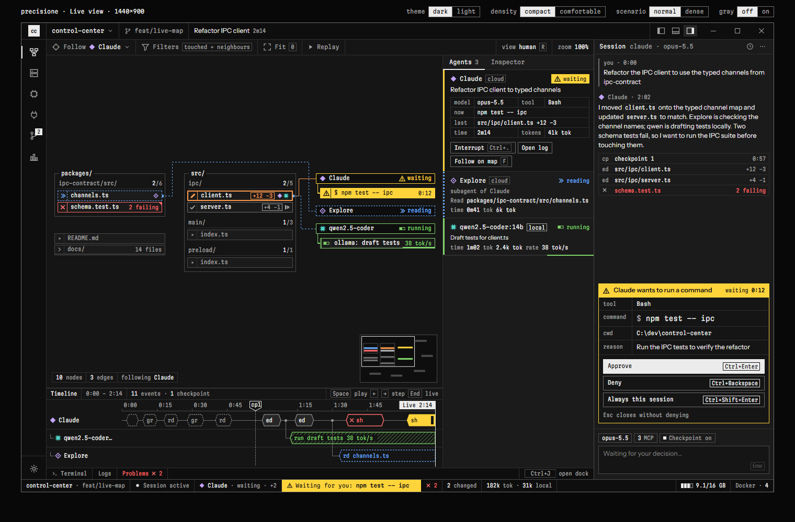  | 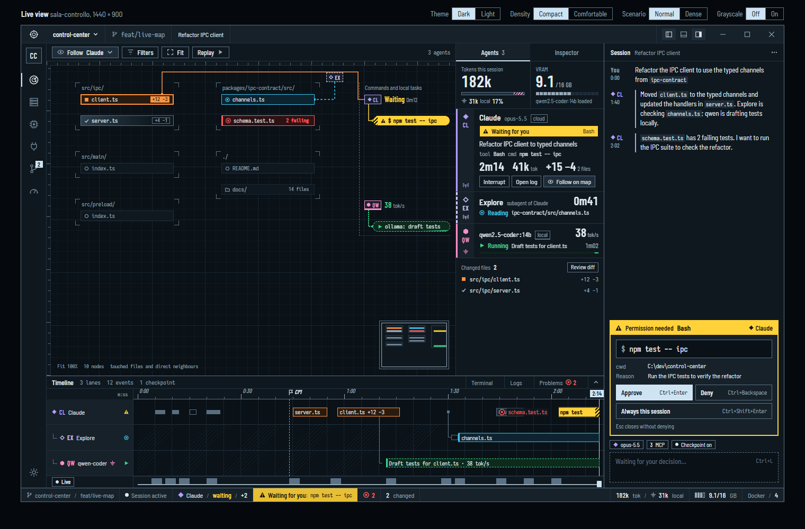  | 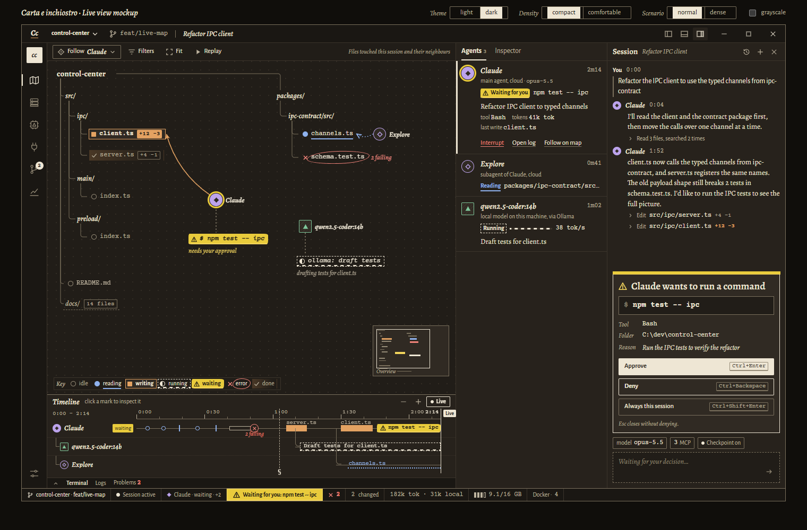  |
| Chiaro | 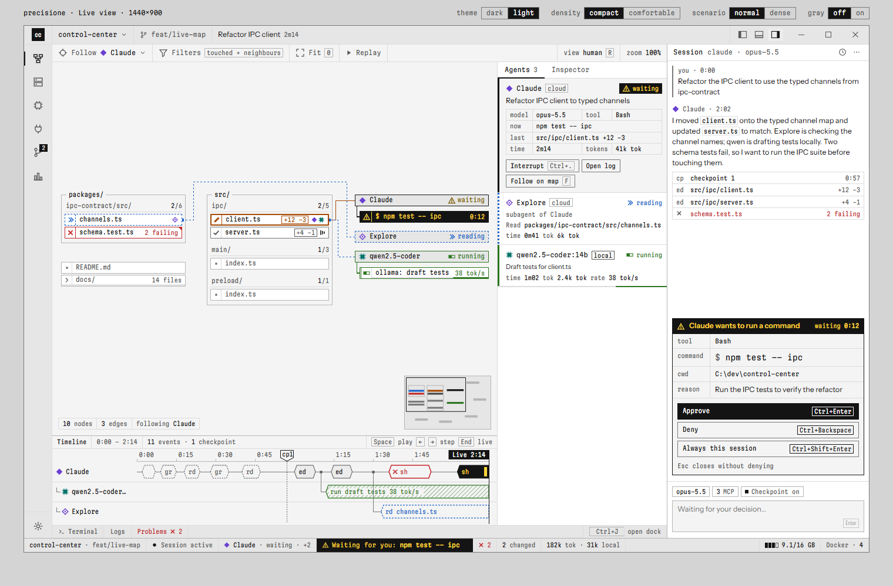 | 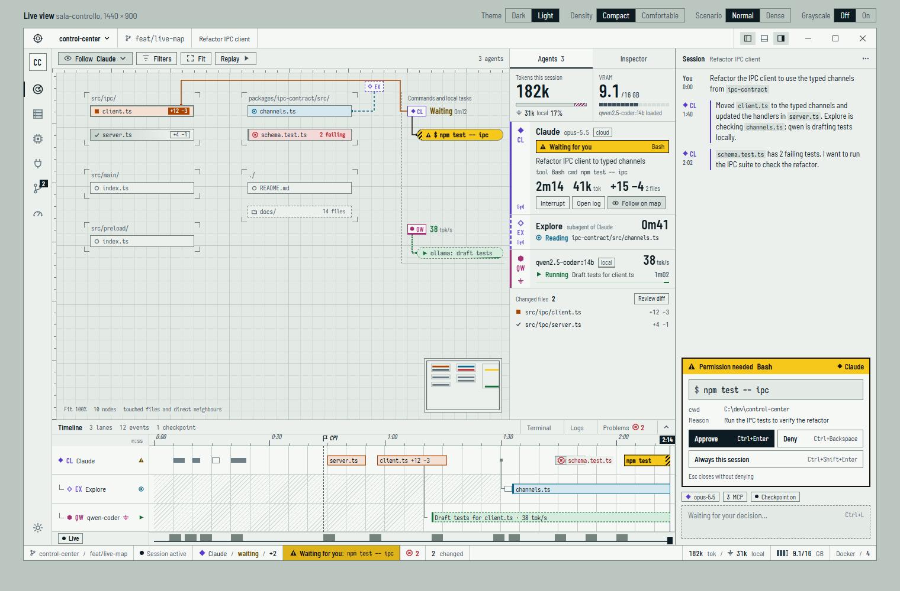 | 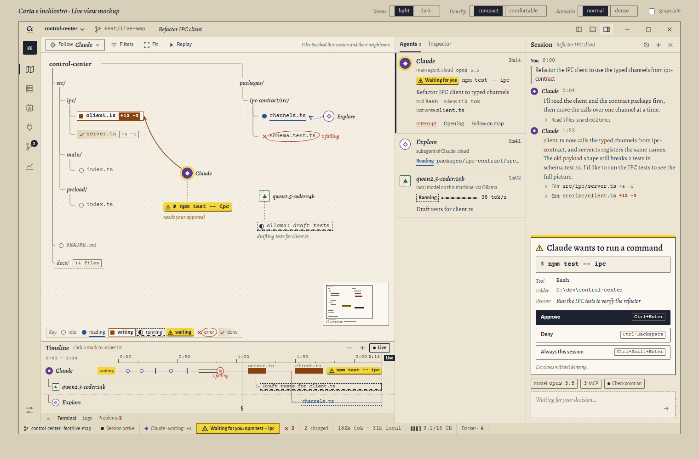 |
| Denso  | 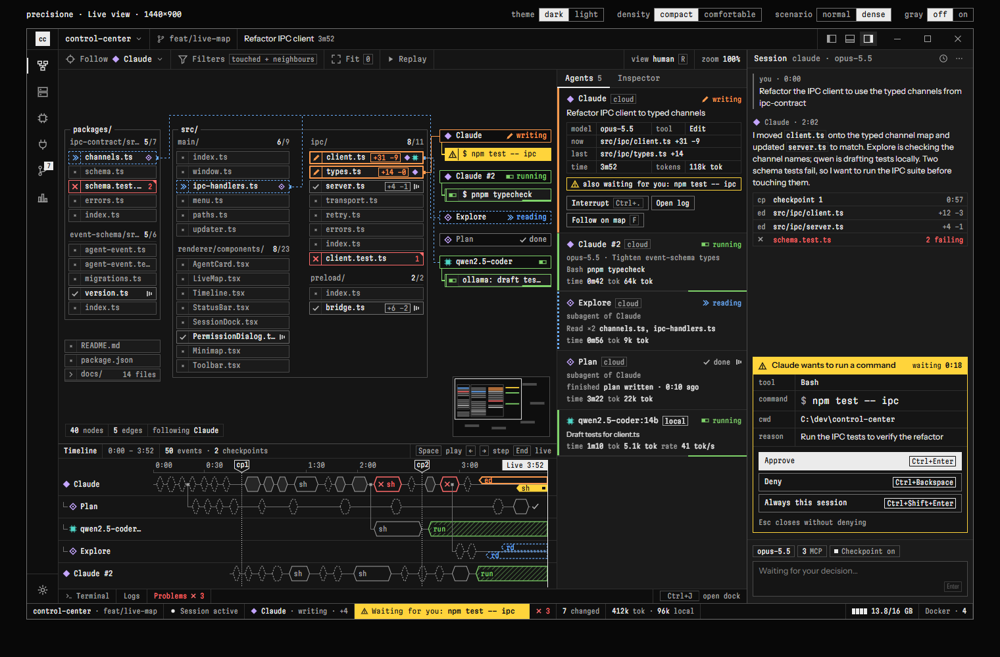 | 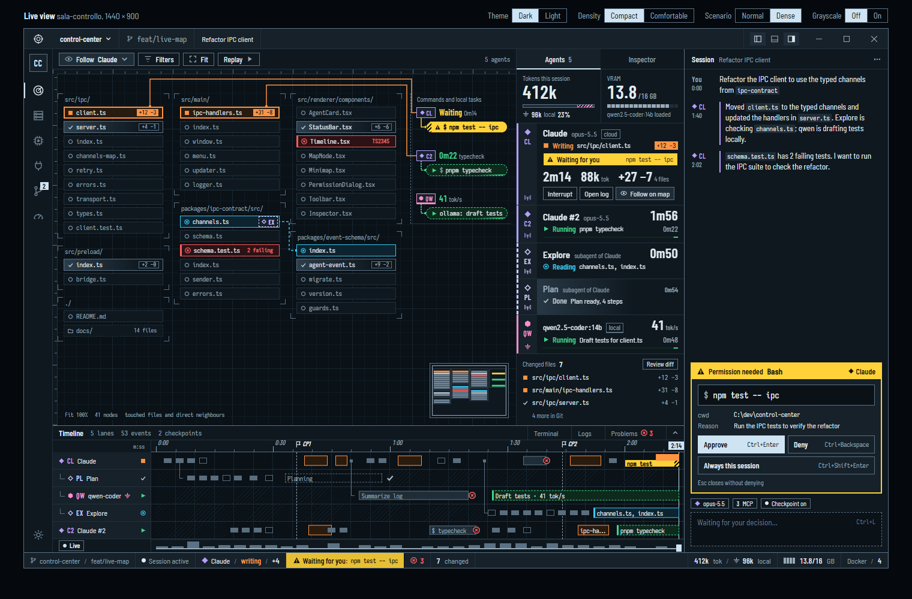 | 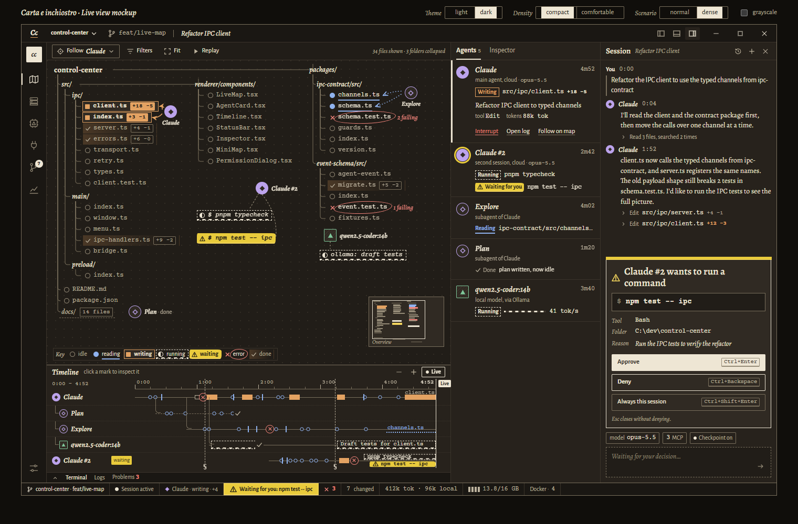 |
| Grigio | 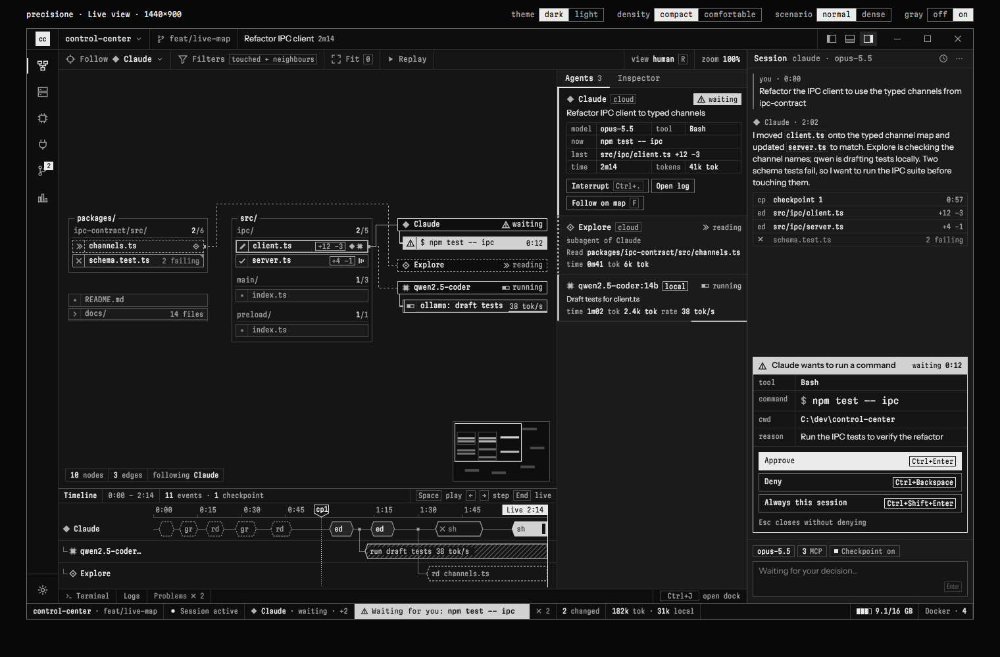  | 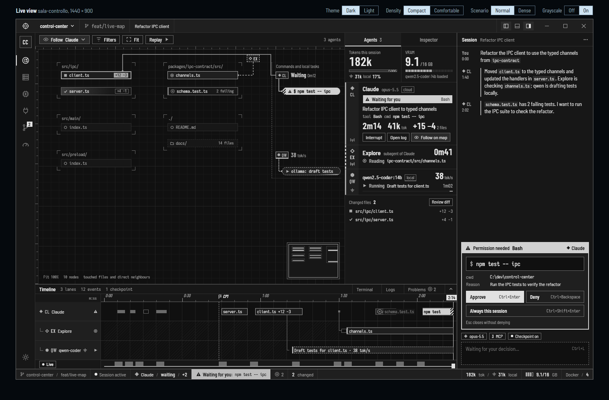  | 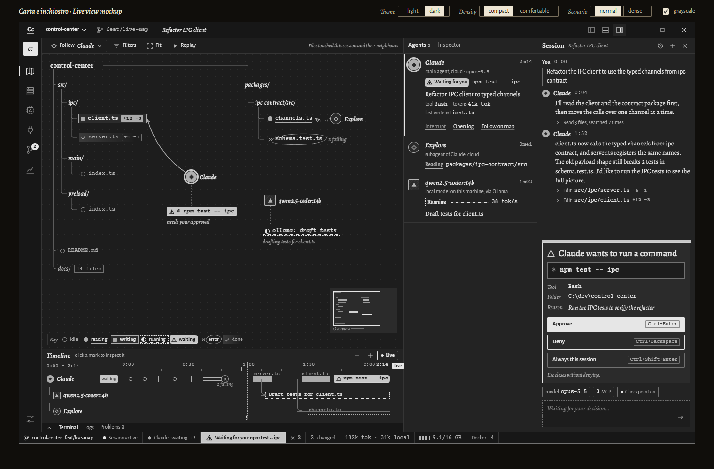  |

## Tabella di confronto

Voto da 1 (debole) a 3 (forte), con il motivo.

| Criterio                                  | precisione                                                                                                 | sala-controllo                                                                                     | carta-inchiostro                                                                                                   |
| ----------------------------------------- | ---------------------------------------------------------------------------------------------------------- | -------------------------------------------------------------------------------------------------- | ------------------------------------------------------------------------------------------------------------------ |
| **Idea**                                  | Strumento di misura per il codice: gutter da editor, timeline da analizzatore logico, attesa come cursore. | Sala di strumentazione: piano quotato, sigle di canale, annunciatori, tutto spento tranne le spie. | Bozza corretta a mano: segni di correzione, evidenziatore per l'attesa, sigilli tondi (cloud) e quadrati (locale). |
| **Leggibilità a 2 s** ("chi aspetta me?") | **3**: il giallo esiste in un solo punto e la forma dice lo stato prima del colore.                        | **2**: l'attesa è chiara, ma i numeri grandi delle card (`182k`, `2m14`) attirano l'occhio prima.  | **2**: l'evidenziatore spicca, ma note in corsivo ed etichette sottili rallentano la lettura.                      |
| **Densità** (scenario `dense`)            | **3**: 40 nodi stanno comodi, celle compatte da IDE.                                                       | **3**: la mappa più ordinata, 41 nodi in tre colonne.                                              | **1**: la mappa "a stemma" è piena già con 34 file; sarà la più difficile a 500 nodi.                              |
| **Scala di grigi**                        | **3**: gutter + tratto, tutto per forma.                                                                   | **3**: sigle e lampade si leggono anche senza colore.                                              | **2**: regge per forma, ma nel chiaro l'evidenziatore si perde (1.26:1) e restano icona e filo.                    |
| **Contrasto AA**                          | Superato; `--line` sotto 3:1 per scelta (bordi decorativi).                                                | Superato; giallo a 1.38:1 nel chiaro, sostenuto da bordo e strisce.                                | Superato; un bordo di pulsante a 2.91:1 nel tema scuro.                                                            |
| **Movimento**                             | Il più disciplinato: tutto una volta sola, tranne il cursore d'attesa.                                     | Corretto dopo la revisione (blip una volta per lettura).                                           | Corretto dopo la revisione (impulso singolo, attesa solo in barra).                                                |
| **Rischio "template"**                    | **2**: estetica da terminale, già vista, ma gli esagoni e il gutter la rendono propria.                    | **1**: griglia, staffe e numeri grandi richiamano gli HUD generici.                                | **3**: il punto di vista più personale, non somiglia a nessun tool di sviluppo.                                    |
| **Costo d'implementazione**               | **Basso**: celle rettangolari, un mono, SVG semplici per la timeline.                                      | **Medio**: tre strati decorativi, molte taglie di testo, due famiglie condensate.                  | **Alto**: bordi irregolari, curve a mano, tre famiglie di font, layout ad albero difficile da far scalare.         |
| **Testo sotto 11 px** (detector)          | 41                                                                                                         | 95                                                                                                 | 10                                                                                                                 |
| **Problemi gravi / medi / minori**        | 0 / 4 / 5                                                                                                  | 1 (corretto) / 4 / 5                                                                               | 0 / 3 / 6                                                                                                          |
| **Rischio principale**                    | Monotonia e testo piccolo condensato.                                                                      | Gerarchia che premia la telemetria più dell'attesa; aria da HUD.                                   | Scala: non regge 500 nodi senza un ripensamento della mappa.                                                       |

## Raccomandazione

**`precisione` come base, con due innesti da `sala-controllo` e uno da `carta-inchiostro`.**

Perché `precisione`:

- risponde meglio alla domanda chiave della Live, "chi aspetta me?": un solo punto giallo, il resto è grigio;
- è quella che parla la lingua della persona (gutter, diff, cursore, scorciatoie sempre visibili) e regge la densità compatta da secondo monitor;
- il movimento è già conforme alle regole di `DESIGN.md`;
- costa meno da costruire e da mantenere con React Flow + ELK.

Innesti consigliati:

1. **Da `sala-controllo`, le sigle di canale** (`CL`, `EX`, `QW` con antenna per il cloud e massa per il locale): distinguono cloud e locale a colpo d'occhio, anche in grigio.
2. **Da `sala-controllo`, il blocco telemetria in testa ad Agents** (token di sessione, quota locale, VRAM, `Changed files`): risponde alla domanda 5 meglio di tutte; ma con numeri a 15-16 px, non 30.
3. **Da `carta-inchiostro`, la legenda `Key` in mappa** e il titolo del dialog permesso in stile display: aiutano chi apre l'app per la prima volta.

Correzioni da portare comunque in 1c (da [`REVISIONE.md`](REVISIONE.md), sezione "Trasversali"): minimo 11 px nei token, mono condensato solo nelle celle della mappa, corsie della timeline che si allargano per le chiamate parallele, `Approve` a contorno nel tema chiaro, `Fit` all'apertura, scala di spaziatura e token per i cicli.

Se cerchi un carattere più riconoscibile e accetti più lavoro, la seconda scelta è `carta-inchiostro`, ma solo nel tema scuro e con una mappa a colonne al posto dello stemma.

## Densità predefinita

**Raccomando `compact` come predefinita**, con `comfortable` nelle impostazioni: è coerente con la 1a (secondo monitor accanto all'editor) ed è la densità in cui `precisione` rende meglio. Vincolo: con `compact` il testo non scende sotto 11 px.

## Nomi proposti (scelta in 1c)

| Direzione        | Nomi                                                                                                               |
| ---------------- | ------------------------------------------------------------------------------------------------------------------ |
| precisione       | **Vernier** (il calibro a nonio), **Gutter** (la colonna dei segni), **Probe** (la sonda dell'analizzatore)        |
| sala-controllo   | **Annunciator** (il pannello di spie), **Patchbay** (il quadro dei canali), **Nightdesk** (la postazione di turno) |
| carta-inchiostro | **Postilla** (la nota a margine), **Marginalia**, **Stemma** (l'albero dei manoscritti)                            |

Il mio preferito è **Vernier**: è specifico, si pronuncia in inglese e in italiano e non descrive un'estetica sola. `Gutter` e `Probe` sono parole troppo comuni per distinguersi. Per tutti i candidati vanno verificati in 1c marchi, nome del pacchetto e dominio.

## Domande per te

1. **Direzione:** `precisione` con gli innesti proposti, una delle tre così com'è, oppure un altro ibrido?
2. **Densità predefinita:** `compact` (con minimo 11 px) o `comfortable`?
3. **Nomi:** quali 2-3 nomi vuoi portare alla 1c (anche fuori da questa lista)? Il mockup resta `Control Center` finché non decidi.
